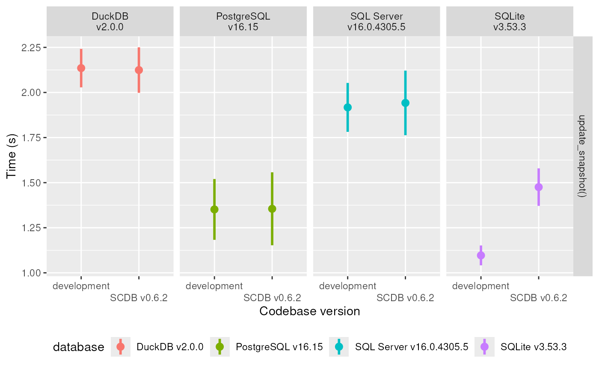
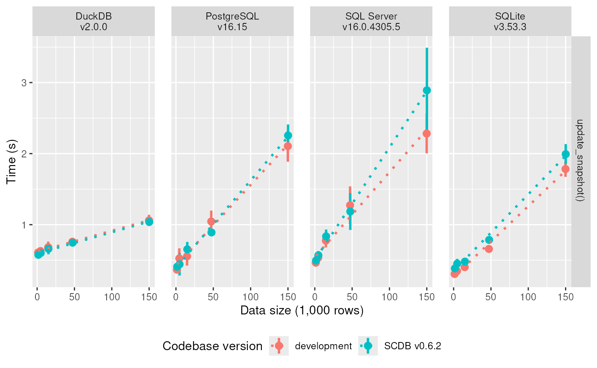

# SCDB: Benchmarks

To showcase the performance of `SCDB` on different database backends, we
include this vignette that summarises a simple benchmark: A sample
dataset is created based on the
[`datasets::iris`](https://rdrr.io/r/datasets/iris.html) dataset. This
data is repeated 10 times and given a unique ID (the row number of the
data).

This data forms the basis for three “snapshots” used in the benchmarks:

1.  The data as described above.

2.  As 1. but where any `Sepal.Length` below the median is halved.

3.  As 2. but where any `Sepal.width` below the median is halved.

The benchmark function uses three consecutive calls to
[`update_snapshot()`](https://ssi-dk.github.io/SCDB/reference/update_snapshot.md)
to create the table with first snapshot and then update it to the second
and third snapshot. Finally, the table is deleted.

The performance of this benchmark function is timed with the
[microbenchmark](https://github.com/joshuaulrich/microbenchmark/)
package using 10 replicates. All benchmarks are run on the same machine.

We include another benchmark to highlight the complexity scaling of the
[`update_snapshot()`](https://ssi-dk.github.io/SCDB/reference/update_snapshot.md)
with the size of the input data. The datasets are similar to the first
benchmark, but the number of repeats is varied to see the impact of
increasing data size. The benchmarks are run from a “clean” state, where
the target_table does not exists. The benchmark measures both the time
to create the table and to remove it again afterwards (to restore the
clean state).

The performance of this benchmark function is timed with the
[microbenchmark](https://github.com/joshuaulrich/microbenchmark/)
package using 5 replicates. All benchmarks are run on the same machine.

The results of the benchmark are shown graphically below (mean and
standard deviation) and with linear scaling (dotted line), where we
compare the current development version of `SCDB` with the current CRAN
version.

NOTE: There are reports of a superlinear complexity for very large data
sets. If you experience such problems, consider batching the updates via
the `filters` argument.

